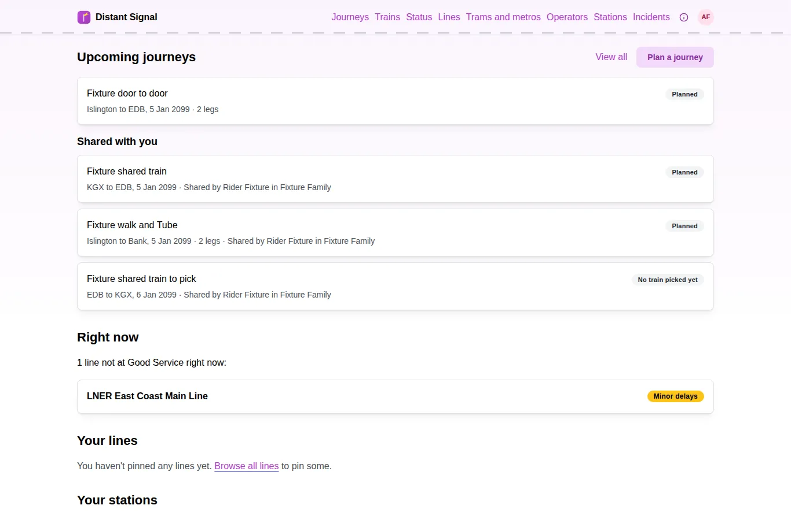

# Distant Signal

A personal UK rail companion: line status, train and journey tracking, trip
planning and Delay Repay support. It is free software, licensed
AGPL-3.0-or-later.

Use it at **[ds.cursed.solutions](https://ds.cursed.solutions/)**.

<picture>
  <source media="(prefers-color-scheme: dark)" srcset="https://raw.githubusercontent.com/Distant-Signal/.github/main/profile/images/home-dark-1366.webp">
  
</picture>

## Repositories

The project is moving out of one repository into several, one at a time.
Repositories marked *planned* don't exist yet; until then their code lives
in `distant-signal`.

| Repository | Role |
|---|---|
| [distant-signal](https://github.com/Distant-Signal/distant-signal) | The frontend and the project's front page. Today it also holds every service, the charts and the line catalogue. All issues live here. |
| ds-core (planned) | The shared crates, the database schema and migrations, grants, the stream envelope and the line catalogue. |
| ds-api (planned) | The api, the trip planner and the timetable services. |
| ds-ingest (planned) | The train movement and timetable feeds. |
| ds-pollers (planned) | The pollers. |
| ds-workers (planned) | The aggregator, enricher and notifier. |
| ds-deploy (planned) | The Helm charts and the deploy tooling. |
| ci (planned) | Shared workflows, actions and the Renovate preset. |
| [.github](https://github.com/Distant-Signal/.github) | This profile and the default security policy, contributing guide and issue forms. |
| DS-MCP (hosted elsewhere) | An MCP server for Distant Signal. It consumes the public API. |

Start with the [main repository's README](https://github.com/Distant-Signal/distant-signal#readme).
